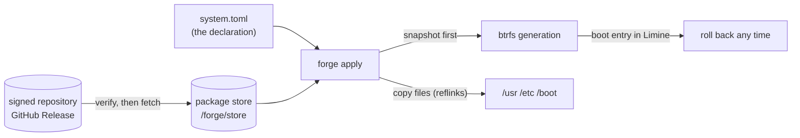

<p align="center">
  <picture>
    <source media="(prefers-color-scheme: dark)" srcset="docs/images/logo-dark.svg">
    
  </picture>
</p>

<h1 align="center">SingularitySYS</h1>

<p align="center">
  <b>A Linux distribution you declare, not configure.</b><br>
  Independent, declarative and rollback-safe, with one tool, <code>forge</code>, written in Rust.
</p>

<p align="center">
  
  
  
  
  
  
  
</p>

<p align="center">
  <a href="#-try-it">Try it</a> ·
  <a href="#-what-makes-it-different">What's different</a> ·
  <a href="#-forge">forge</a> ·
  <a href="#-how-it-works">How it works</a> ·
  <a href="#-status">Status</a> ·
  <a href="#-build-it">Build</a> ·
  <a href="DESIGN.md">Design</a>
</p>

---

SingularitySYS is not derived from Arch, Debian or anything else. The base system, the package manager,
the installer, the image builder and the kernel tool are all one codebase, and the whole system is described by
a file you can read:

```toml
# /etc/forge/system.toml
hostname = "nova"
libc     = "glibc"
timezone = "Europe/Paris"
init     = "openrc"          # or "systemd": forge apply installs it and removes the other
shell    = "bash"            # or fish, zsh, ...: installed for you
repos    = ["https://github.com/noxilith/SingularitySYS/releases/download/repo-glibc"]

# The packages you chose. The base system (shell, networking, forge itself, ...) is always there and not listed.
packages = """
  git,
  htop,
"""

[[users]]
name   = "ada"
groups = ["wheel", "audio", "video"]
```

Edit it with `sudo forge edit` (or press Ctrl+H in a shell): when you close the editor the file is checked and the
machine converges to it, users and groups included. If you don't like the result, boot the previous **generation**
from the Limine menu.

## 🚀 Try it

> [!WARNING]
> Early software. It has been installed and used on the author's hardware and very little else.
> Don't put it on a machine you can't reinstall. See [Status](#-status) for what is and isn't verified.

1. **Boot the live ISO** (Limine, BIOS and UEFI). Log in as `root`, password `root`.
2. **Partition the disk** with `cfdisk` (an EFI partition of about 512 MB, and the rest for the system).
3. **Install:**

   ```sh
   forge strap /dev/sdX2 /dev/sdX1     # root partition first, then the boot / EFI partition
   ```

   This erases those partitions. It lays out btrfs (`@  @snapshots  @home  @store`), installs Limine, creates
   your user, and writes the starter `system.toml`.
4. **Reboot**, then manage the system with `forge`:

   ```sh
   sudo forge install htop
   sudo forge upgrade
   forge kernel build --auto && sudo forge kernel install
   ```

## ✨ What makes it different

<table>
  <tr>
    <td width="50%" valign="top">
      <h3>📜 Declarative</h3>
      One file describes the machine: hostname, locale, time zone, users and groups, services, kernel
      modules, packages. <code>forge apply</code> makes the system match it, and tells you what it will
      change before it does.
    </td>
    <td width="50%" valign="top">
      <h3>⏪ Generations you can roll back</h3>
      The root is btrfs. Every change snapshots the system first, and each snapshot gets its own boot entry.
      A bad update is one reboot away from being undone.
    </td>
  </tr>
  <tr>
    <td width="50%" valign="top">
      <h3>🔐 Signed packages</h3>
      Binary archives live in a GitHub Release. The index is signed with ed25519, every archive is
      hash-checked, and a repository that goes backwards in time is refused as a rollback attack.
    </td>
    <td width="50%" valign="top">
      <h3>🛠️ Source recipes, sandboxed</h3>
      Every package has a recipe. Builds run in a Linux-namespace sandbox with no network and only the
      tools the recipe names, and the toolchain rebuilds itself from its own packages.
    </td>
  </tr>
  <tr>
    <td width="50%" valign="top">
      <h3>🧠 A kernel that fits your machine</h3>
      <code>forge kernel build --auto</code> fetches the sources, checks them, and builds a kernel trimmed to the
      modules your machine actually loads (or the full set, or your own config). It fetches its own build
      tools from the repository, and removes them afterwards.
    </td>
    <td width="50%" valign="top">
      <h3>🦀 One binary</h3>
      <code>forge</code> is the package manager, installer, image builder, generation manager and kernel tool.
      The base is dynamically linked against glibc, with OpenRC as the init system.
    </td>
  </tr>
</table>

## 🔧 forge

| Command | What it does |
|---|---|
| `forge install NAME…` · `forge remove NAME…` | Add or remove packages in the declaration, then apply it |
| `forge upgrade` | Move every declared package to the newest version in the repositories |
| `forge list` · `forge search [TERM]` | What is installed · what the repositories offer |
| `forge doctor` | Check the system over (init link, boot entries, base packages, users, services, clock, microcode) and say what to run about any problem |
| `sudo forge edit` | Open `/etc/forge/system.toml` in your editor (micro by default); when you close it, it is checked and applied |
| `forge apply` | Converge the machine to `/etc/forge/system.toml` (`--dry-run` shows the plan) |
| `forge gen` | List, create and roll back generations |
| `forge kernel list \| build \| install` | Find, build and install kernels |
| `forge strap ROOT BOOT` | Install onto partitions you made (from the live ISO) |
| `forge iso` | Build the live ISO |
| `forge build RECIPE` | Build a package from source, in the sandbox |
| `forge store`, `forge repo`, `forge key` | The package store, repositories and signing keys |

## 🌌 How it works



- **The system is a normal tree.** `forge apply` copies each package's files into the real `/usr` with btrfs
  reflinks, so there's no link farm to boot through, third-party software sees an ordinary Linux system, and
  `sudo` and `passwd` can be setuid. A state file records exactly which files forge put there: it replaces and
  removes those, and never touches anything else. `/etc` and the kernel are never overwritten or deleted.
- **Merged `/usr`.** `/bin`, `/sbin` and `/lib` are symlinks into `/usr`. The package builder rejects any package that
  installs into them directly.
- **Dependencies are found, not typed.** After a build, `forge` reads the ELF headers of what was installed and
  records the packages that provide the libraries it needs.
- **Nothing is trusted on the way in.** Indexes are signed, archives are hash-checked and unpacked defensively,
  and downloads come over plain HTTP(S) only because everything is verified afterwards.

## 📍 Status

Early and experimental. The full account, including what was **not** verified, is in [`DESIGN.md`](DESIGN.md).

| | |
|---|---|
| ✅ **Verified on real hardware** | the glibc live ISO (boots into RAM, Wi-Fi, verified HTTPS downloads), installing it to disk with `forge strap` and booting the result, `forge search` against the signed release |
| 🔄 **In progress** | checking an installed system end to end: `forge install` and `forge upgrade` of the base, rolling back a generation, building a kernel with `forge kernel` on glibc |
| ⏳ **Not yet verified** | the per-user declaration, Bluetooth, other people's hardware |

<details>
<summary><b>Roadmap</b></summary>

- More packages (an editor, htop, git ...) as they are needed
- `forge apply user`: per-user package sets
- Device permissions for the `audio`, `video` and `input` groups
- Bluetooth, and Wi-Fi in the declaration
- `forge kernel --menuconfig` inside the sandbox
- Rebuilding the toolchain with itself and comparing the results

</details>

## 🧱 Build it

```sh
cargo build                        # forge and its libraries
cargo test --workspace             # the unit and CLI tests
cargo clippy --workspace --all-targets
```

Building the whole system from source takes hours and tens of gigabytes. The scripts are in [`scripts/`](scripts):
`bootstrap-glibc.sh` (the toolchain), `build-glibc-world.sh` (every package, into a repository), `package-forge.sh`
and `build-iso.sh`. The host needs `gcc`, `make`, `bison`, `flex`, `python3`, `perl`, `xorriso`, `mksquashfs`,
`openssl` and `limine`.

| Path | What |
|---|---|
| `crates/` | `forge` and its libraries: declaration, apply, generations, strap, store, build, kernel, ISO |
| `recipes/` | Package recipes: source, build steps, dependencies, including the kernel |
| `scripts/` | Bootstrapping the toolchain, building the packages and the ISO, tests that need root |
| `distro/keys/` | The public key that signs the package repository. The secret key is never in git |
| [`DESIGN.md`](DESIGN.md) | The design, the status of each part, and what is not verified |

## 📄 License

The workspace is licensed `MIT OR Apache-2.0`. Package recipes build third-party software, which keeps its own license.

<p align="center">
  <picture>
    <source media="(prefers-color-scheme: dark)" srcset="docs/images/logo-dark.svg">
    
  </picture>
</p>
